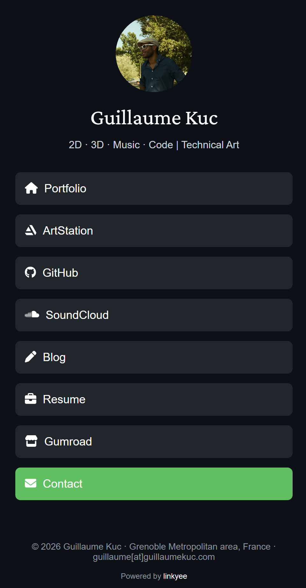

# Links

My link-in-bio page: one place that points to my portfolio, ArtStation, GitHub, SoundCloud, blog, resume, shop and contact.

**Live:** [guillaumekuc.github.io/links](https://guillaumekuc.github.io/links/)

<p align="center">
  
</p>

It is a static page generated from a single config file, built with [Linkyee](https://github.com/ZhgChgLi/linkyee) and hosted on GitHub Pages. The avatar hover (halftone dots and emblem), the green accent and the Crimson Pro title match my [portfolio](https://guillaumekuc.art/) and [blog](https://guillaumekuc.github.io/blog/).

## How it works

| Path | Role |
| --- | --- |
| `config.yml` | Page content: name, tagline, links, footer |
| `themes/default/` | Template, styles, scripts and images |
| `scaffold.rb` | Renders the theme with the config into `docs/` |
| `docs/` | Generated site served by GitHub Pages. Do not edit by hand |

## Updating the page

Requires Ruby and Bundler.

```bash
bundle install
```

1. Edit `config.yml` (content) or `themes/default/` (look and feel).
2. Rebuild `docs/`:

   ```bash
   npm run build
   ```

3. Commit both the source change and the regenerated `docs/`, then push to `main`. GitHub Pages redeploys in about a minute.

To give a link the accent color, add `class: "highlight"` to it in `config.yml`.

## Credits

Based on [Linkyee](https://github.com/ZhgChgLi/linkyee) by ZhgChgLi, under the MIT License (see `LICENSE`).
